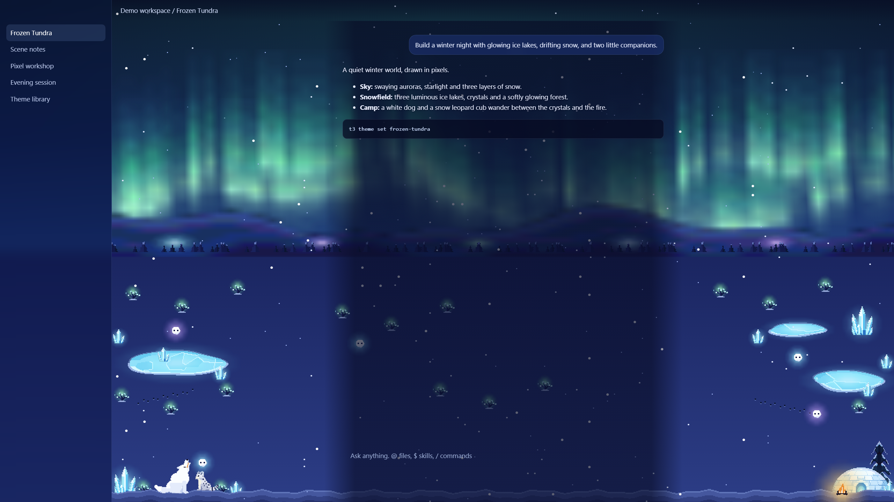

<p align="center">
  
</p>

<p align="center">
  <strong>Two little worlds for your workspace.</strong><br>
  Animated pixel art, luminous scenery, and frosted panels for T3 Code.
</p>

<p align="center">
  <a href="#deep-sea">Deep Sea</a> ·
  <a href="#frozen-tundra">Frozen Tundra</a> ·
  <a href="#installation">Installation</a> ·
  <a href="#make-it-your-own">Source &amp; rebuilding</a>
</p>

## Choose your world

| | Deep Sea | Frozen Tundra |
| :-- | :-- | :-- |
| **Mood** | A living reef beneath turquoise water | A winter night beneath the aurora |
| **Companions** | Fish, turtles, and jellyfish | A white dog, a snow leopard cub, and snow spirits |
| **Light** | Sunbeams, plankton, and golden stones | Ice-blue crystals and a warm campfire |
| **Theme ID** | `deep-sea` | `frozen-tundra` |
| **Get the theme** | [Download JSON](https://raw.githubusercontent.com/bigmoumou/JH-T3-Code-Themes/main/deep-sea/theme.json) | [Download JSON](https://raw.githubusercontent.com/bigmoumou/JH-T3-Code-Themes/main/frozen-tundra/theme.json) |

## Deep Sea

**A reef that keeps living while you work.**

[](deep-sea/preview.png)

- **Life at every depth.** Sardines near the surface, tangs and butterflyfish in midwater, and luminous jellyfish closer to the floor.
- **A breathing seabed.** Clownfish, coral, swaying kelp, glowing stones, and drifting plankton fill the edges.
- **Room for your work.** The scenery follows the chat column, with foreground detail gathered beside the frosted composer.

**[Download Deep Sea](https://raw.githubusercontent.com/bigmoumou/JH-T3-Code-Themes/main/deep-sea/theme.json)** · [Explore the source](deep-sea/)

## Frozen Tundra

**Cold skies. Warm company.**

[](frozen-tundra/preview.png)

- **A sky in motion.** Two swaying aurora curtains, occasional shooting stars, and three layers of drifting snow.
- **An enchanted snowfield.** Three glowing ice lakes, blue crystals, luminous grass, floating snow spirits, and faint lights behind distant firs.
- **Two traveling companions.** A white dog and a snow leopard cub wander between the crystals and the campfire in a 96-second cycle, pausing to sit, howl, and play.

**[Download Frozen Tundra](https://raw.githubusercontent.com/bigmoumou/JH-T3-Code-Themes/main/frozen-tundra/theme.json)** · [Explore the source](frozen-tundra/)

*Previews are offline mock-ups of the T3 layout with synthetic English conversations, not captures of private sessions. Open an image for the full-size view; the installed themes are animated.*

## Installation

### Ask your T3 agent

Paste either request into a **Full access** thread on the machine serving your T3 environment:

```text
Install the deep-sea theme from https://github.com/bigmoumou/JH-T3-Code-Themes.
Follow the repository's installation instructions and keep its CSS unchanged.
```

```text
Install the frozen-tundra theme from https://github.com/bigmoumou/JH-T3-Code-Themes.
Follow the repository's installation instructions and keep its CSS unchanged.
```

<details>
<summary><strong>Installation steps for agents and manual setup</strong></summary>

1. Read the local guide with `t3_theme_read` when available.
2. Download `<id>/theme.json` from this repository. Preserve its CSS exactly; both themes are close to T3's 20,000-character limit.
3. Save it as `<id>.json` in the **server environment's** themes directory. Write a temporary file and rename it into place.

   | Default environment | Themes directory |
   | :-- | :-- |
   | Windows | `%USERPROFILE%\.t3\userdata\themes\` |
   | macOS / Linux | `~/.t3/userdata/themes/` |

   With `T3CODE_HOME`, use its `userdata/themes/` directory. With a custom state directory, use its `themes/` subdirectory.

4. Call `t3_theme_set` with the chosen `themeId` and `appearance: "dark"`. If the T3 CLI is available, use:

   ```sh
   t3 theme set deep-sea
   # or
   t3 theme set frozen-tundra
   ```

5. Without activation tools, select the published theme under **Settings → Appearance** and choose dark appearance. Ask the user to confirm the result; publishing a theme is not a visual inspection.

</details>

### Return to a built-in theme

Ask your agent to switch to `t3-chat`, or select a built-in theme under **Settings → Appearance**. With the CLI:

```sh
t3 theme set t3-chat
```

The custom theme files can stay in place for later use.

## Compatibility & practical notes

- **Custom CSS required.** Developed and installed on Windows with T3 Code `0.1.10-nightly.20261114.4669`. macOS and Linux have not been verified.
- **Desktop and web.** These environment themes do not apply to the native mobile app.
- **Self-contained scenes.** Artwork is generated by the included Python source and embedded in the theme. No external images, fonts, or injected JavaScript are needed at runtime.
- **Continuous animation.** CPU/GPU use is higher than with a static theme and varies with the machine, window size, and display scaling. Switch to a built-in theme for a static workspace.
- **Layout-dependent styling.** Some selectors extend beyond T3's documented stable hooks. Future T3 updates may require adjustments; the previews do not cover every panel configuration.

## Make it your own

| File in each theme folder | Purpose |
| :-- | :-- |
| `art.py` | Draws pixel-art sprites and soft lighting layers. |
| `build_theme.py` | Packs the artwork and builds the SVG/CSS animation. |
| `theme.json` | Ready-to-install theme with embedded artwork. |
| `preview.png` | English demonstration image shown above. |

Rebuilding requires Python 3, NumPy, and Pillow with WebP support:

```sh
python -m pip install numpy pillow
cd frozen-tundra   # or: cd deep-sea
python build_theme.py
```

The builder also writes `scene.svg`, `sheet.png`, and `mock.html` for local inspection. It must report **`problems: none`** before installation.

| Theme | Published CSS length | T3 limit | Remaining |
| :-- | --: | --: | --: |
| Deep Sea | 19,964 characters | 20,000 | 36 |
| Frozen Tundra | 19,961 characters | 20,000 | 39 |

Different Pillow/WebP versions can change the encoded size. Recheck the budget after rebuilding; the published JSON files are the reference artifacts.

---

Made for [T3 Code](https://github.com/pingdotgg/t3code). Inspired by the community's [animated theme experiments](https://x.com/OvalStrictly/status/2121464096566444150). An independent collection, not an official T3 Tools project.
