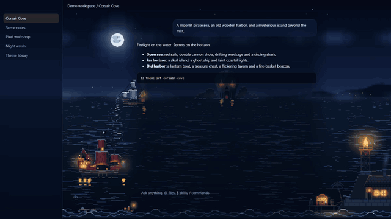
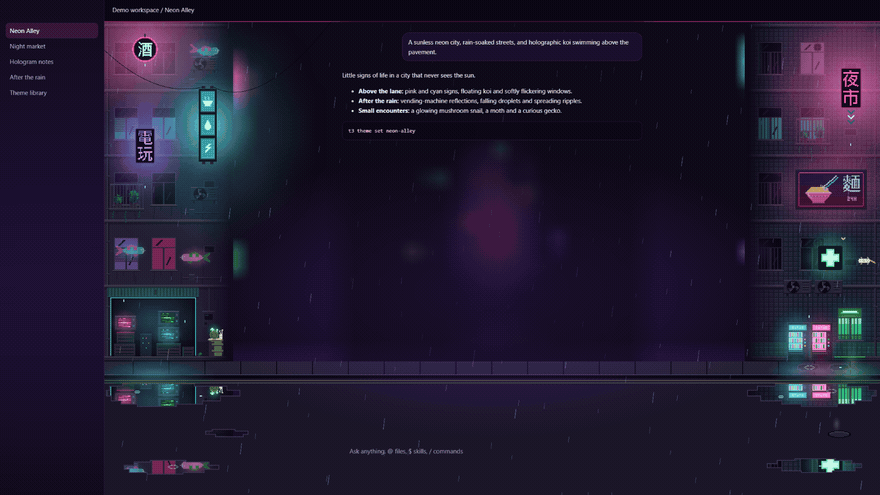
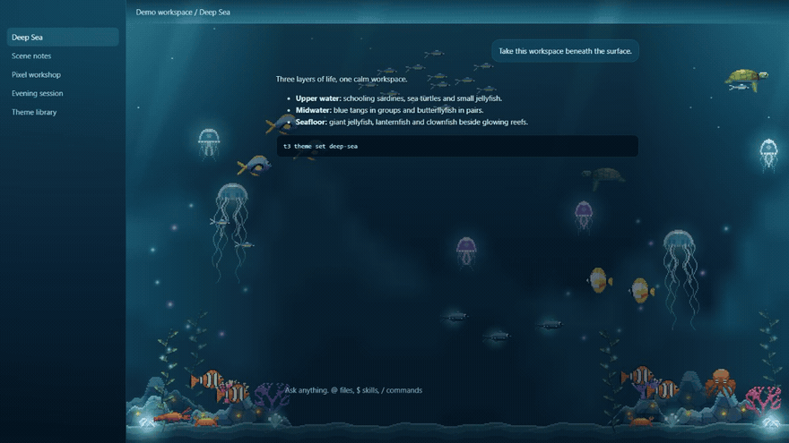
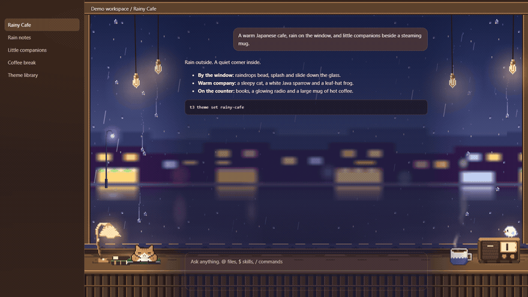

<p align="center">
  <a href="https://bigmoumou.github.io/JH-T3-Code-Themes/#corsair-cove"></a>
</p>

<p align="center">
  <strong>A cozy little escape for your workspace.</strong><br>
  Dark, cute, animated pixel-art themes for T3 Code.<br>Comfortable on the eyes. A little space to unwind.
</p>

<p align="center">
  <a href="#corsair-cove">Corsair Cove</a> ·
  <a href="#neon-alley">Neon Alley</a> ·
  <a href="#frozen-tundra">Frozen Tundra</a> ·
  <a href="#deep-sea">Deep Sea</a> ·
  <a href="#rainy-cafe">Rainy Cafe</a> ·
  <a href="#installation">Installation</a> ·
  <a href="#make-it-your-own">Source &amp; rebuilding</a>
</p>

<p align="center">
  <strong><a href="https://bigmoumou.github.io/JH-T3-Code-Themes/">Explore the live gallery →</a></strong><br>
  <em>Select a picture to open its live scene, then switch between all five worlds.</em>
</p>

<p align="center">
  <a href="https://bigmoumou.github.io/JH-T3-Code-Themes/#corsair-cove"></a>
  <a href="https://bigmoumou.github.io/JH-T3-Code-Themes/#neon-alley"></a>
  <br>
  <a href="https://bigmoumou.github.io/JH-T3-Code-Themes/#frozen-tundra"></a>
  <a href="https://bigmoumou.github.io/JH-T3-Code-Themes/#deep-sea"></a>
  <br>
  <a href="https://bigmoumou.github.io/JH-T3-Code-Themes/#rainy-cafe"></a>
</p>

## Choose your world

| Theme | World | Signature motion | Download |
| :-- | :-- | :-- | :-- |
| **[Corsair Cove](#corsair-cove)** | An old pirate harbor after dark | Cannon fire, drifting flames, and rolling waves | [JSON](https://raw.githubusercontent.com/bigmoumou/JH-T3-Code-Themes/main/corsair-cove/theme.json) |
| **[Neon Alley](#neon-alley)** | A sunless cyberpunk lane | Holographic koi, neon lights, and puddle ripples | [JSON](https://raw.githubusercontent.com/bigmoumou/JH-T3-Code-Themes/main/neon-alley/theme.json) |
| **[Frozen Tundra](#frozen-tundra)** | A luminous winter night | Auroras, snow, and animal companions | [JSON](https://raw.githubusercontent.com/bigmoumou/JH-T3-Code-Themes/main/frozen-tundra/theme.json) |
| **[Deep Sea](#deep-sea)** | A living underwater reef | Swimming fish and drifting jellyfish | [JSON](https://raw.githubusercontent.com/bigmoumou/JH-T3-Code-Themes/main/deep-sea/theme.json) |
| **[Rainy Cafe](#rainy-cafe)** | A Japanese cafe on a rainy night | Window droplets, little companions, and rising coffee steam | [JSON](https://raw.githubusercontent.com/bigmoumou/JH-T3-Code-Themes/main/rainy-cafe/theme.json) |

## Corsair Cove

**Firelight on the water. Secrets on the horizon.**

<a href="https://bigmoumou.github.io/JH-T3-Code-Themes/#corsair-cove"></a>

- **A battle on the open sea.** A red-sailed carrack fires two shots, 0.6 seconds apart; splashes rise beside the distant trader before it returns fire. Wreckage drifts nearby and a shark patrols below.
- **Firelight adrift.** Four burning planks and two wooden barrels drift across the right-hand sea. Each piece bobs at its own pace, with flickering firelight and reflections on the water.
- **An old harbor, alive with light.** A lantern boat bobs on the waves, a tavern flickers, and a timber fire-basket beacon casts warm light over the water. An open treasure chest waits on the jetty.
- **Mystery beyond the mist.** A fire-eyed skull island, a passing ghost ship, distant coastal lights, layered swells, and occasional whitecaps complete the night.

**[Open live demo](https://bigmoumou.github.io/JH-T3-Code-Themes/#corsair-cove)** · [Download Corsair Cove](https://raw.githubusercontent.com/bigmoumou/JH-T3-Code-Themes/main/corsair-cove/theme.json) · [Source](corsair-cove/) · [GIF recording](corsair-cove/preview.gif) · [High-resolution still](corsair-cove/preview.png)

## Neon Alley

**Small wonders in a city that never sees the sun.**

<a href="https://bigmoumou.github.io/JH-T3-Code-Themes/#neon-alley"></a>

- **A city built in layers.** Lit apartment windows, a noodle billboard, an arcade alcove and a glowing pharmacy cross frame a dark lane. The right-hand vending machine stays pink.
- **Light over wet pavement.** Three holographic koi swim in the air, including a pink fish with green fins. Puddles reflect the signs and shop fronts; air-conditioner drops land with a splash and a spreading ripple.
- **Little stories at the edges.** A snail carrying glowing mushrooms reacts to a falling drop, while a gecko stalks a moth beside the pharmacy cross. Windows belonging to the same room flicker together.

**[Open live demo](https://bigmoumou.github.io/JH-T3-Code-Themes/#neon-alley)** · [Download Neon Alley](https://raw.githubusercontent.com/bigmoumou/JH-T3-Code-Themes/main/neon-alley/theme.json) · [Source](neon-alley/) · [GIF recording](neon-alley/preview.gif) · [High-resolution still](neon-alley/preview.png)


## Frozen Tundra

**Cold skies. Warm company.**

<a href="https://bigmoumou.github.io/JH-T3-Code-Themes/#frozen-tundra"></a>

- **A sky in motion.** Two swaying aurora curtains, occasional shooting stars, and three layers of drifting snow.
- **An enchanted snowfield.** Three glowing ice lakes, blue crystals, luminous grass, floating snow spirits, and faint lights behind distant firs.
- **Two traveling companions.** A white dog and a snow leopard cub wander between the crystals and the campfire in a 96-second cycle, pausing to sit, howl, and play.

**[Open live demo](https://bigmoumou.github.io/JH-T3-Code-Themes/#frozen-tundra)** · [Download Frozen Tundra](https://raw.githubusercontent.com/bigmoumou/JH-T3-Code-Themes/main/frozen-tundra/theme.json) · [Source](frozen-tundra/) · [GIF recording](frozen-tundra/preview.gif) · [High-resolution still](frozen-tundra/preview.png)

## Deep Sea

**A reef that keeps living while you work.**

<a href="https://bigmoumou.github.io/JH-T3-Code-Themes/#deep-sea"></a>

- **Life at every depth.** Sardines near the surface, tangs and butterflyfish in midwater, and luminous jellyfish closer to the floor.
- **A breathing seabed.** Clownfish, coral, swaying kelp, glowing stones, and drifting plankton fill the edges.
- **Room for your work.** The scenery follows the chat column, with foreground detail gathered beside the frosted composer.

**[Open live demo](https://bigmoumou.github.io/JH-T3-Code-Themes/#deep-sea)** · [Download Deep Sea](https://raw.githubusercontent.com/bigmoumou/JH-T3-Code-Themes/main/deep-sea/theme.json) · [Source](deep-sea/) · [GIF recording](deep-sea/preview.gif) · [High-resolution still](deep-sea/preview.png)

## Rainy Cafe

**Rain outside. A quiet corner inside.**

<a href="https://bigmoumou.github.io/JH-T3-Code-Themes/#rainy-cafe"></a>

- **Rain on both sides of the glass.** Three layers of slanted rain cross the street outside, while beads splash onto the pane and slide down in little starts and stops.
- **A warm place to settle.** Japanese woodwork, pendant lights, books and a glowing radio frame the counter. Three wisps of steam rise from a large blue-and-white coffee mug.
- **Little companions.** An orange-and-white cat naps, watches the rain and visits the radio. A white Java sparrow flies over and hops to greet it; a leaf-hat frog occasionally climbs the window. The cat and bird share a 96-second cycle, with the frog appearing every second cycle.

**[Open live demo](https://bigmoumou.github.io/JH-T3-Code-Themes/#rainy-cafe)** · [Download Rainy Cafe](https://raw.githubusercontent.com/bigmoumou/JH-T3-Code-Themes/main/rainy-cafe/theme.json) · [Source](rainy-cafe/) · [GIF recording](rainy-cafe/preview.gif) · [High-resolution still](rainy-cafe/preview.png)

*All animated previews use an 880 × 495 frame at 10 fps. The looping GIFs show 32 seconds each of Corsair Cove and Neon Alley, 24 seconds of Frozen Tundra, 14 seconds of Deep Sea, and a 32-second excerpt of Rainy Cafe beginning 20 seconds into its companion cycle. They are recordings of offline T3-layout mock-ups with synthetic English conversations. Select any scene image for the live gallery; the GIF and still-image links remain available for recordings.*

## Installation

### Ask your T3 agent

Paste any request into a **Full access** thread on the machine serving your T3 environment:

```text
Install the corsair-cove theme from https://github.com/bigmoumou/JH-T3-Code-Themes.
Follow the repository's installation instructions and keep its CSS unchanged.
```

```text
Install the neon-alley theme from https://github.com/bigmoumou/JH-T3-Code-Themes.
Follow the repository's installation instructions and keep its CSS unchanged.
```

```text
Install the frozen-tundra theme from https://github.com/bigmoumou/JH-T3-Code-Themes.
Follow the repository's installation instructions and keep its CSS unchanged.
```

```text
Install the deep-sea theme from https://github.com/bigmoumou/JH-T3-Code-Themes.
Follow the repository's installation instructions and keep its CSS unchanged.
```

```text
Install the rainy-cafe theme from https://github.com/bigmoumou/JH-T3-Code-Themes.
Follow the repository's installation instructions and keep its CSS unchanged.
```

<details>
<summary><strong>Installation steps for agents and manual setup</strong></summary>

1. Read the local guide with `t3_theme_read` when available.
2. Download `<id>/theme.json` from this repository. Preserve its CSS exactly; the themes are close to T3's 20,000-character limit.
3. Save it as `<id>.json` in the **server environment's** themes directory. Write a temporary file and rename it into place.

   | Default environment | Themes directory |
   | :-- | :-- |
   | Windows | `%USERPROFILE%\.t3\userdata\themes\` |
   | macOS / Linux | `~/.t3/userdata/themes/` |

   With `T3CODE_HOME`, use its `userdata/themes/` directory. With a custom state directory, use its `themes/` subdirectory.

4. Call `t3_theme_set` with the chosen `themeId` and `appearance: "dark"`. If the T3 CLI is available, use:

   ```sh
   t3 theme set corsair-cove
   # or
   t3 theme set neon-alley
   # or
   t3 theme set frozen-tundra
   # or
   t3 theme set deep-sea
   # or
   t3 theme set rainy-cafe
   ```

5. Without activation tools, select the published theme under **Settings → Appearance** and choose dark appearance. Ask the user to confirm the result; publishing a theme is not a visual inspection.

</details>

### Return to a built-in theme

Ask your agent to switch to `t3-chat`, or select a built-in theme under **Settings → Appearance**. With the CLI:

```sh
t3 theme set t3-chat
```

The custom theme files can stay in place for later use.

## Compatibility & practical notes

- **Custom CSS required.** Developed and installed on Windows with T3 Code `0.1.10-nightly.20261114.4669`. macOS and Linux have not been verified.
- **Desktop and web.** These environment themes do not apply to the native mobile app.
- **Self-contained scenes.** Artwork is generated by the included Python source and embedded in the theme. No external images, fonts, or injected JavaScript are needed at runtime.
- **Continuous animation.** CPU/GPU use is higher than with a static theme and varies with the machine, window size, and display scaling. Switch to a built-in theme for a static workspace.
- **Layout-dependent styling.** Some selectors extend beyond T3's documented stable hooks. Future T3 updates may require adjustments; the previews do not cover every panel configuration.

## Make it your own

| File in each theme folder | Purpose |
| :-- | :-- |
| `art.py` | Draws pixel-art sprites and soft lighting layers. |
| `build_theme.py` | Packs the artwork and builds the SVG/CSS animation. |
| `theme.json` | Ready-to-install theme with embedded artwork. |
| `preview.gif` | Looping animated demonstration shown above. |
| `preview.png` | High-resolution English demonstration still. |

Rebuilding requires Python 3, NumPy, and Pillow with WebP support:

```sh
python -m pip install numpy pillow
cd neon-alley   # or: cd corsair-cove / cd frozen-tundra / cd deep-sea / cd rainy-cafe
python build_theme.py
```

The builder also writes `scene.svg`, `sheet.png`, and `mock.html` for local inspection. It must report **`problems: none`** before installation.

| Theme | Published CSS length | T3 limit | Remaining |
| :-- | --: | --: | --: |
| Corsair Cove | 19,944 characters | 20,000 | 56 |
| Neon Alley | 19,967 characters | 20,000 | 33 |
| Frozen Tundra | 19,961 characters | 20,000 | 39 |
| Deep Sea | 19,964 characters | 20,000 | 36 |
| Rainy Cafe | 19,461 characters | 20,000 | 539 |

Different Pillow/WebP versions can change the encoded size. Recheck the budget after rebuilding; the published JSON files are the reference artifacts.

### Update the live gallery

After updating a theme, regenerate its demo from the published JSON and the English mock:

```sh
python build_gallery.py
```

Commit the generated `demo/` pages with the theme. GitHub Pages publishes `main` from the repository root; `.nojekyll` keeps the site static. The gallery loads one live scene at a time and respects the browser's reduced-motion preference. Its small JavaScript controller switches scenes; the artwork and motion remain the themes' original CSS.


---

Made for [T3 Code](https://github.com/pingdotgg/t3code). Inspired by the community's [animated theme experiments](https://x.com/OvalStrictly/status/2121464096566444150). An independent collection, not an official T3 Tools project.
