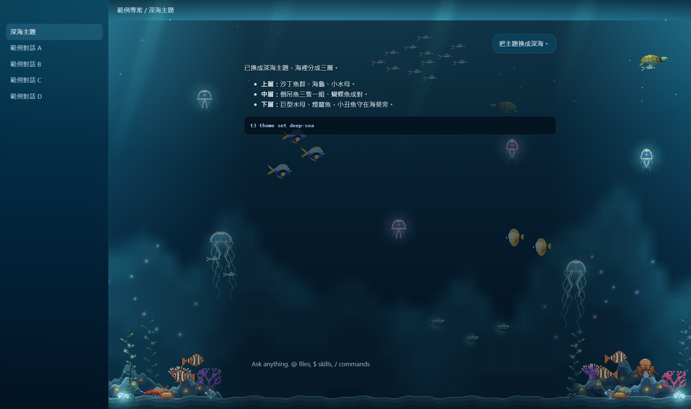

# JH T3 Code Themes

Animated pixel-art themes for T3 Code (desktop and web). Every picture is drawn by code; there are no third-party assets.

T3 Code 的動態像素風主題，所有圖像都由程式產生。

| Theme | `id` | File |
| --- | --- | --- |
| **深海 Deep Sea**: a living seabed behind frosted panels | `deep-sea` | [`deep-sea/theme.json`](deep-sea/theme.json) |

## Install

In T3 Code, tell your agent:

> Install the `deep-sea` theme from https://github.com/bigmoumou/T3-Code-Themes

### Steps for the agent

1. Download `https://raw.githubusercontent.com/bigmoumou/T3-Code-Themes/main/<id>/theme.json`. Keep it byte for byte: its `css` sits just under T3's limit of 20,000 characters.
2. Save it as `<T3 home>/userdata/themes/<id>.json`. T3 home is `$T3CODE_HOME` if that is set, otherwise `~/.t3` (`%USERPROFILE%\.t3` on Windows).
3. Call `t3_theme_set` with `themeId: "<id>"`. If you have no such tool or it is refused, ask the user to choose the theme under Settings → Appearance.
4. You cannot see the result: ask the user how it looks.

To undo, call `t3_theme_set` with a built-in id (`t3-chat`, `grove`, `ocean`, `ember` or `iris`) and delete the file.

## Good to know

- Tested on Windows with T3 Code nightly 0.1.10, where an agent installed it by steps 2 and 3. macOS, Linux and choosing the theme by hand in Settings are untested.
- The scene never stops moving and costs about half a CPU core.
- It styles a few elements that are not on T3's list of stable selectors, so a T3 update may break it.

## Rebuild

In a theme's folder, `python build_theme.py` writes `theme.json` next to itself from the sprites that `art.py` paints. It needs Python with NumPy and Pillow, and it must print `problems: none`: the theme is 36 characters under T3's limit, and another version of the WebP encoder can tip it over.
