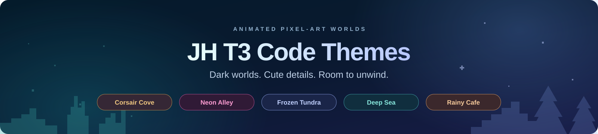
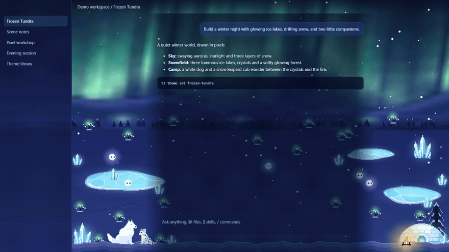

<p align="center">
  
</p>

<p align="center">
  <strong>A cozy little escape for your workspace.</strong><br>
  Dark, cute, animated pixel-art themes for T3 Code.<br>Comfortable on the eyes. A little space to unwind.
</p>

<p align="center">
  <a href="#deep-sea">Deep Sea</a> ·
  <a href="#frozen-tundra">Frozen Tundra</a> ·
  <a href="#corsair-cove">Corsair Cove</a> ?
  <a href="#installation">Installation</a> ·
  <a href="#make-it-your-own">Source &amp; rebuilding</a>
</p>

<p align="center">
  <a href="#deep-sea"></a>
  <a href="#frozen-tundra"></a>
  <a href="#corsair-cove"></a>
  <br><em>Watch the worlds move. Select a preview to explore its theme.</em>
</p>

## Choose your world

| Theme | World | Signature motion | Download |
| :-- | :-- | :-- | :-- |
| **[Deep Sea](#deep-sea)** | A living underwater reef | Swimming fish and drifting jellyfish | [JSON](https://raw.githubusercontent.com/bigmoumou/JH-T3-Code-Themes/main/deep-sea/theme.json) |
| **[Frozen Tundra](#frozen-tundra)** | A luminous winter night | Auroras, snow, and animal companions | [JSON](https://raw.githubusercontent.com/bigmoumou/JH-T3-Code-Themes/main/frozen-tundra/theme.json) |
| **[Corsair Cove](#corsair-cove)** | An old pirate harbor after dark | Cannon fire, rolling waves, and flickering lanterns | [JSON](https://raw.githubusercontent.com/bigmoumou/JH-T3-Code-Themes/main/corsair-cove/theme.json) |

## Deep Sea

**A reef that keeps living while you work.**

<a href="deep-sea/preview.gif"></a>

- **Life at every depth.** Sardines near the surface, tangs and butterflyfish in midwater, and luminous jellyfish closer to the floor.
- **A breathing seabed.** Clownfish, coral, swaying kelp, glowing stones, and drifting plankton fill the edges.
- **Room for your work.** The scenery follows the chat column, with foreground detail gathered beside the frosted composer.

**[Download Deep Sea](https://raw.githubusercontent.com/bigmoumou/JH-T3-Code-Themes/main/deep-sea/theme.json)** · [Explore the source](deep-sea/) · [High-resolution still](deep-sea/preview.png)

## Frozen Tundra

**Cold skies. Warm company.**

<a href="frozen-tundra/preview.gif"></a>

- **A sky in motion.** Two swaying aurora curtains, occasional shooting stars, and three layers of drifting snow.
- **An enchanted snowfield.** Three glowing ice lakes, blue crystals, luminous grass, floating snow spirits, and faint lights behind distant firs.
- **Two traveling companions.** A white dog and a snow leopard cub wander between the crystals and the campfire in a 96-second cycle, pausing to sit, howl, and play.

**[Download Frozen Tundra](https://raw.githubusercontent.com/bigmoumou/JH-T3-Code-Themes/main/frozen-tundra/theme.json)** · [Explore the source](frozen-tundra/) · [High-resolution still](frozen-tundra/preview.png)

## Corsair Cove

**Firelight on the water. Secrets on the horizon.**

<a href="corsair-cove/preview.gif"></a>

- **A battle on the open sea.** A red-sailed carrack fires two shots, 0.6 seconds apart; splashes rise beside the distant trader before it returns fire. Wreckage drifts nearby and a shark patrols below.
- **An old harbor, alive with light.** A lantern boat bobs on the waves, a tavern flickers, and a timber fire-basket beacon casts warm light over the water. An open treasure chest waits on the jetty.
- **Mystery beyond the mist.** A fire-eyed skull island, a passing ghost ship, distant coastal lights, layered swells, and occasional whitecaps complete the night.

**[Download Corsair Cove](https://raw.githubusercontent.com/bigmoumou/JH-T3-Code-Themes/main/corsair-cove/theme.json)** ? [Explore the source](corsair-cove/) ? [High-resolution still](corsair-cove/preview.png)

*All animated previews use an 880 × 495 frame at 10 fps. The looping GIFs show 14 seconds of Deep Sea, 24 seconds of Frozen Tundra, and 32 seconds of Corsair Cove. They are recordings of offline T3-layout mock-ups with synthetic English conversations, not captures of private sessions. Open a GIF for the larger animated view, or use the still-image links for more detail.*

## Installation

### Ask your T3 agent

Paste any request into a **Full access** thread on the machine serving your T3 environment:

```text
Install the deep-sea theme from https://github.com/bigmoumou/JH-T3-Code-Themes.
Follow the repository's installation instructions and keep its CSS unchanged.
```

```text
Install the frozen-tundra theme from https://github.com/bigmoumou/JH-T3-Code-Themes.
Follow the repository's installation instructions and keep its CSS unchanged.
```

```text
Install the corsair-cove theme from https://github.com/bigmoumou/JH-T3-Code-Themes.
Follow the repository's installation instructions and keep its CSS unchanged.
```

<details>
<summary><strong>Installation steps for agents and manual setup</strong></summary>

1. Read the local guide with `t3_theme_read` when available.
2. Download `<id>/theme.json` from this repository. Preserve its CSS exactly; the themes are close to T3's 20,000-character limit.
3. Save it as `<id>.json` in the **server environment's** themes directory. Write a temporary file and rename it into place.

   | Default environment | Themes directory |
   | :-- | :-- |
   | Windows | `%USERPROFILE%\.t3\userdata\themes\` |
   | macOS / Linux | `~/.t3/userdata/themes/` |

   With `T3CODE_HOME`, use its `userdata/themes/` directory. With a custom state directory, use its `themes/` subdirectory.

4. Call `t3_theme_set` with the chosen `themeId` and `appearance: "dark"`. If the T3 CLI is available, use:

   ```sh
   t3 theme set deep-sea
   # or
   t3 theme set frozen-tundra
   # or
   t3 theme set corsair-cove
   ```

5. Without activation tools, select the published theme under **Settings → Appearance** and choose dark appearance. Ask the user to confirm the result; publishing a theme is not a visual inspection.

</details>

### Return to a built-in theme

Ask your agent to switch to `t3-chat`, or select a built-in theme under **Settings → Appearance**. With the CLI:

```sh
t3 theme set t3-chat
```

The custom theme files can stay in place for later use.

## Compatibility & practical notes

- **Custom CSS required.** Developed and installed on Windows with T3 Code `0.1.10-nightly.20261114.4669`. macOS and Linux have not been verified.
- **Desktop and web.** These environment themes do not apply to the native mobile app.
- **Self-contained scenes.** Artwork is generated by the included Python source and embedded in the theme. No external images, fonts, or injected JavaScript are needed at runtime.
- **Continuous animation.** CPU/GPU use is higher than with a static theme and varies with the machine, window size, and display scaling. Switch to a built-in theme for a static workspace.
- **Layout-dependent styling.** Some selectors extend beyond T3's documented stable hooks. Future T3 updates may require adjustments; the previews do not cover every panel configuration.

## Make it your own

| File in each theme folder | Purpose |
| :-- | :-- |
| `art.py` | Draws pixel-art sprites and soft lighting layers. |
| `build_theme.py` | Packs the artwork and builds the SVG/CSS animation. |
| `theme.json` | Ready-to-install theme with embedded artwork. |
| `preview.gif` | Looping animated demonstration shown above. |
| `preview.png` | High-resolution English demonstration still. |

Rebuilding requires Python 3, NumPy, and Pillow with WebP support:

```sh
python -m pip install numpy pillow
cd corsair-cove   # or: cd deep-sea / cd frozen-tundra
python build_theme.py
```

The builder also writes `scene.svg`, `sheet.png`, and `mock.html` for local inspection. It must report **`problems: none`** before installation.

| Theme | Published CSS length | T3 limit | Remaining |
| :-- | --: | --: | --: |
| Deep Sea | 19,964 characters | 20,000 | 36 |
| Frozen Tundra | 19,961 characters | 20,000 | 39 |
| Corsair Cove | 19,940 characters | 20,000 | 60 |

Different Pillow/WebP versions can change the encoded size. Recheck the budget after rebuilding; the published JSON files are the reference artifacts.

---

Made for [T3 Code](https://github.com/pingdotgg/t3code). Inspired by the community's [animated theme experiments](https://x.com/OvalStrictly/status/2121464096566444150). An independent collection, not an official T3 Tools project.
